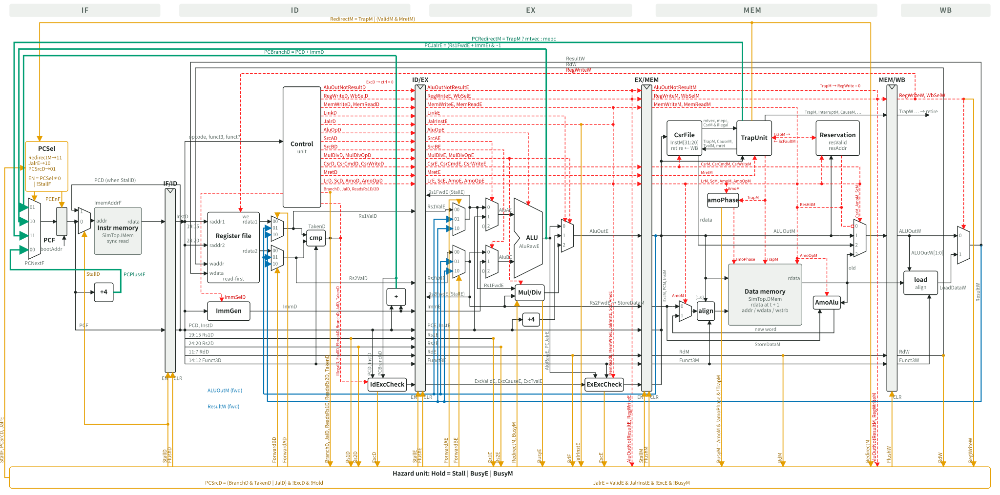

# rv32core

An RV32IMA instruction-set simulator in C++, a bare-metal C runtime, INT8
neural-network inference on top of it, and a five-stage pipelined RV32IMA
core in Chisel that is verified against the simulator instruction by
instruction.

| Part | What it is | Where |
|---|---|---|
| ISA simulator | RV32IMA + Zicsr, M-mode traps and CSRs, ELF loader, retire trace, distinct exit codes for every way a run can fail | [`isa_sim/`](isa_sim/) |
| Bare-metal runtime | `crt0.S` (gp/sp setup, `.bss` clearing, `tohost` exit), linker script with a stack-overflow check, shared host/target harness | [`workload/common/`](workload/common/) |
| Workloads | parameterized GEMM; INT8 MobileNetV1 and ResNet18 (CIFAR-10) with per-operator benchmarks | [`workload/`](workload/) |
| Quantization | PyTorch FP32 training, post-training INT8 quantization, a Python integer reference | [`ml/`](ml/), [`workload/common/QUANT.md`](workload/common/QUANT.md) |
| RTL core | five-stage in-order RV32IMA pipeline: full forwarding, branches in ID, multi-cycle divider, LR/SC and AMOs, precise traps | [`rtl/`](rtl/), [`rtl/DESIGN.md`](rtl/DESIGN.md) |
| Verification | lockstep trace compare, riscv-tests on both sides, directed hazard tests, coverage, fault injection, self-tests | [`verification/`](verification/) |



## Results

| Check | Result | Evidence |
|---|---|---|
| riscv-tests (rv32ui, rv32um, rv32ua), ISA simulator | 58 pass, 0 fail, 2 expected failures | [`riscv_tests_isa_sim.log`](verification/isa_compliance/riscv_tests_isa_sim.log) |
| riscv-tests, RTL, each run also trace-compared with the simulator | 58 pass, 0 fail, 2 expected failures | [`riscv_tests_rtl.log`](verification/isa_compliance/riscv_tests_rtl.log) |
| GEMM lockstep, RTL vs simulator, 9 shapes up to 64x64x64 (1.88M instructions) | 9 / 9 | [`gemm_lockstep_rtl.log`](verification/lockstep/gemm_lockstep_rtl.log) |
| Directed pipeline tests (forwarding, stalls, branches, M, CSR, traps, A, fence) | 13 / 13 on both | [`verification/lockstep/`](verification/lockstep/) |
| Self-tests: GEMM shapes and build checks, every operator layer, simulator error paths | 103 / 103 | [`verification/self_tests/`](verification/self_tests/) |
| Chisel unit tests (chiseltest) | 72 / 72 | `cd rtl && sbt test` |
| INT8 models, Python reference vs C on the host vs C on RV32IMA | 0 differing logits | [`bitexact.log`](verification/int8_models/bitexact.log) |
| INT8 accuracy, CIFAR-10 test set (10,000 images) | ResNet18-w16 92.44% (FP32 92.71%), MobileNetV1-0.5 90.88% (FP32 90.79%) | [quantization reports](workload/resnet18/quantization_report.md) |
| Functional coverage over 82 RTL runs | every stall, flush, forwarding path and trap cause | [`coverage_report.md`](verification/coverage/coverage_report.md) |
| GEMM CPI on the RTL | 1.14; 98.5% of lost cycles are the taken-branch flush | [`docs/PERFORMANCE.md`](docs/PERFORMANCE.md) |

The two expected failures are design choices the ISA allows, and they fail
identically on both sides: `fence_i` (the memories are Harvard, so code
written to data memory cannot be fetched) and `ma_data` (misaligned accesses
trap). Details in [`verification/isa_compliance/`](verification/isa_compliance/).

## How the pieces check each other

```
              C source (GEMM, INT8 model)
             /                          \
   native build (host)            RV32IMA ELF (crt0.S + link.ld)
        |                          /                 \
   golden output           isa_sim (C++)          RTL core (Chisel -> Verilator)
        |                     |      \               /      |
        +------ compare ------+       retire traces         |
        |                             compared line by line |
        +------------------ compare result dump ------------+
```

- The **host build** of a workload is the golden output.
- The **ISA simulator** must match it bit for bit, and passes riscv-tests.
- The **RTL** must match the golden, and must also produce the same retire
  trace as the simulator: pc, instruction, register write, memory write and
  trap of every instruction, so a bug shows up at the first instruction that
  differs, not at the end of a run.
- **Fault injection** turns off one hazard mechanism at a time and records
  which suite notices, to show the suites can actually fail
  ([`verification/fault_injection/`](verification/fault_injection/)).

## Quick start

Requirements: `g++` (C++17), Python 3 (standard library only), a RISC-V
GCC that can target `rv32ima` (any of `riscv64-unknown-elf-`,
`riscv32-unknown-elf-`, `riscv-none-elf-`), and for the RTL: sbt with a
JDK 8 to 17 (Scala 2.12.15 does not run on JDK 21) and Verilator 4 or 5.

```sh
# GEMM on the ISA simulator, compared with the host
make -C workload/gemm host riscv GEMM_M=13 GEMM_N=7 GEMM_K=5
./workload/gemm/gemm_host > /tmp/golden.hex
isa_sim/run_isa_sim.sh workload/gemm/gemm.elf /tmp/isa
cmp /tmp/golden.hex /tmp/isa/output_tensor.hex && echo match

# The same ELF on the RTL core (first run generates Verilog and builds Verilator)
rtl/run_rtl_sim.sh workload/gemm/gemm.elf /tmp/rtl
cmp /tmp/golden.hex /tmp/rtl/data_sram_dump.hex && echo match

# Test suites
bash verification/self_tests/run_gemm_shapes.sh
bash verification/isa_compliance/build_riscv_tests.sh      # clones riscv-tests once
bash verification/isa_compliance/run_riscv_tests.sh --rtl
bash verification/lockstep/run_gemm_lockstep.sh
(cd rtl && sbt test)
```

## Repository layout

```
isa_sim/                 C++ ISA simulator, run_isa_sim.sh
rtl/                     Chisel core, Verilator testbench (tb/), DESIGN.md, diagram
workload/common/         crt0.S, link.ld, harness.h, INT8 kernels, model tools, QUANT.md
workload/gemm/           GEMM workload and its data generator
workload/mobilenet/      INT8 MobileNetV1 weights, operator benchmarks, report
workload/resnet18/       INT8 ResNet18 weights, operator benchmarks, report
ml/                      FP32 training (PyTorch); not needed to build anything else
verification/            isa_compliance, lockstep, self_tests, coverage,
                         int8_models, fault_injection
docs/PERFORMANCE.md      cycle counts and where the cycles go
```

## License

MIT, see [`LICENSE`](LICENSE).
